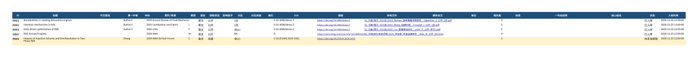

# survey-workbench-hub

[English](README_EN.md)

面向科研文献调研的 Agent Skill 仓库。输入研究方向和具体调研问题，自动跑完检索、公开全文下载、分类归档、PDF 解析、Excel/SQLite 建库、研究现状报告撰写以及汇报 PPT 生成。

目前支持 10 个开放学术源自动聚合检索（含国内可直连的 PLOS、DataCite 等），另附 28 个中文与机构库的一键检索入口。闭源文献不做绕墙处理，按条目留存 DOI 和获取通道；是否使用学校/机构权限为可选项，没有授权可直接走文献传递。

> **课题组编程学习网站**：<https://zerocode.xin/login>
>
> **交流群**：1061940027（QQ）
>
> 网站和群里都会持续分享免费的编程与 AI Coding 资料，欢迎进来交流学习；动手能力强的同学后续也有机会和我们团队一起参与实际工程任务。

## 1. 关于项目

这个项目由课题组发起并维护，最初是为了把开题、写基金本子前反复要做的“找论文、下 PDF、重命名、建表、整理研究现状、做组会 PPT”串成一套可复用的流程。具体维护记录可直接看 Git 提交历史，平时有使用问题或合作需求都可以进 QQ 群联系。

写这套 Skill 时我们定了几条基本底线：

- **查不到的信息不瞎填**：影响因子、分区和论文里的具体数值拿不到就留空标「待核实」；闭源文献老实给出 DOI、失败原因和补救方式，不假装已经下下来了。
- **解析与清理口径统一**：涉及文件归类、去重和索引刷新的判断尽量收敛到同一处脚本，避免前后结果打架。
- **尽量给可直接接着用的产物**：每一步落盘具体的目录、索引表、报告或可编辑 PPT，而不是只给几段泛泛的文字建议。

## 2. 快速开始

装好 Skill 后，可以在支持的 Agent 里输入 `/survey-workbench` 触发，也可以直接描述调研主题和问题，例如：

```text
帮我按阶段梳理「无人机气动外形优化」的国内外研究现状，先建可查的资料库，最后给我报告和汇报 PPT。
```

运行后会在当前目录生成 `survey_<主题>/`，主要文件如下：

| 产物 | 路径 |
|---|---|
| 归档文献与资料 | `01_文献/`、`02_开放资料/` |
| 解析正文与表格 | `03_解析全文/md/`、`txt/`、`tables/` |
| 索引库 | `00_索引/索引表.xlsx`（7 张表）+ `library.db` |
| 未获取清单 | `05_报告/未获取资料清单.md`（DOI + 可点链接） |
| 调研报告 | `05_报告/研究现状_<主题>.md` / `.docx` |
| 汇报 PPT | `05_报告/<主题>_汇报.pptx` |

## 3. 安装与依赖

### 3.1 通过 `npx skills` 安装（推荐）

```bash
npx skills add pkssbttywblj/survey-workbench-hub --list
npx skills add pkssbttywblj/survey-workbench-hub --agent codex --skill survey-workbench --yes --copy
```

### 3.2 Claude Code

```bash
git clone https://github.com/pkssbttywblj/survey-workbench-hub.git ~/ai-skills/survey-workbench-hub
mkdir -p ~/.claude/skills
ln -s ~/ai-skills/survey-workbench-hub/skills/survey-workbench ~/.claude/skills/survey-workbench
```

### 3.3 WorkBuddy / Codex

把 `skills/survey-workbench` 整个文件夹放进对应工具的 skills 目录即可。Windows 下建议用目录联接，后面拉取更新不用手动再拷一份：

```cmd
mklink /J "%USERPROFILE%\.workbuddy\skills\survey-workbench" "C:\ai-skills\survey-workbench-hub\skills\survey-workbench"
```

### 3.4 其他 Agent 与 Python 依赖

手动安装时请保留完整目录（`scripts/`、`references/`、`ppt_skill/` 缺一不可），不要只复制单个 `SKILL.md`。

Python 运行依赖：

```bash
pip install openpyxl pymupdf pdfplumber python-docx beautifulsoup4 python-pptx
# 可选：安装 curl_cffi 可提高部分出版社站点的下载成功率
```

## 4. 技能列表

| 技能 | 状态 | 作用 | 常用触发词 | 说明文档 |
|---|---|---|---|---|
| `survey-workbench` | Beta | 关键词 → 文献库 → 研究现状报告 → 汇报 PPT | 文献调研、建文献库、研究现状、下载论文和公开资料 | [查看详情](skills/survey-workbench/README.md) |

## 5. 仓库结构与参与贡献

```text
skills/survey-workbench/
├── SKILL.md            # 主流程说明
├── scripts/            # 15 个流程脚本（含检索、解析、索引、报告校验与 PPT 交接包）
├── references/         # 写作规范、目录命名、数据源说明、OCR 与跨平台移植指南
├── ppt_skill/          # 内置 CN Academic Spark 中文学术 PPT 引擎（MIT）
├── templates/          # 精读笔记卡片模板
└── evals/              # 评测用例
examples/demo_library/  # 示例调研库产物
assets/                 # 实测展示图与汇报文件
```

如果你打算新增数据源、补全 OCR 后端、调整 PPT 样式或往仓库里加新技能，可以按下面步骤操作：

1. 在 `skills/` 下新建对应技能目录，补齐 `SKILL.md` 及中英文 README；
2. 规则文档放 `references/`，可执行脚本放 `scripts/`；
3. 在上方「技能列表」中补一行记录；
4. 提交前跑一遍 `python scripts/validate_repo.py`，确认中英文目录结构、图片路径和脚本语法全部通过。

## 6. 实测效果展示

下面这组展示产物，是我们在 **WorkBuddy + DeepSeek V4.1 Flash** 环境下加载 `survey-workbench` 后，直接输入以下提示词跑出来的实际结果：

```text
survey-workbench
,请你使用此skill在当前目录下对“无人机气动外形优化”进行调研，调研问题为：（1）找到给出详细几何参数的无人机模型；（2）调研出无人机气动外形优化所用的优化算法；（3）调研出无人机气动外形优化的难点和挑战，请执行
```

其中，**汇报 PPT 部分**基于同一份调研报告与资料库，使用 **Gemini 4 Neon** 按照本 Skill 的 Route D 文献综述规范重新制作了一稿（18 页全原生可编辑矢量，嵌入调研库实测论文原图；对应成品已放入 `assets/`：[下载 PPTX](assets/无人机气动外形优化_汇报.pptx) ｜ [预览 PDF](assets/无人机气动外形优化_汇报.pdf)）。

| 产物 | 预览 |
|---|---|
| Excel 索引表 |  |
| Word 调研报告 |  |
| 未获取资料清单 |  |
| 规范化目录 |  |
| 汇报 PPT 总览（Gemini 4 Neon 按本 Skill 规范生成） |  |
| 多模态读页输入 |  |
