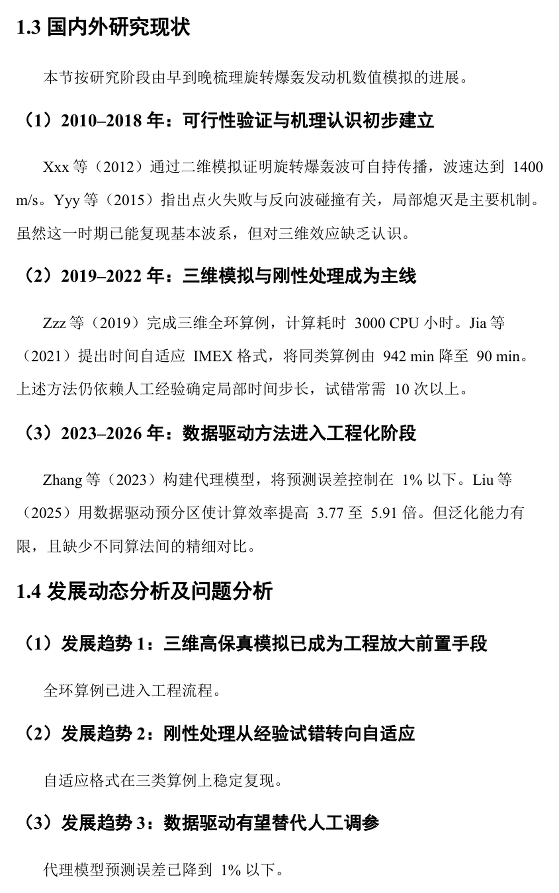
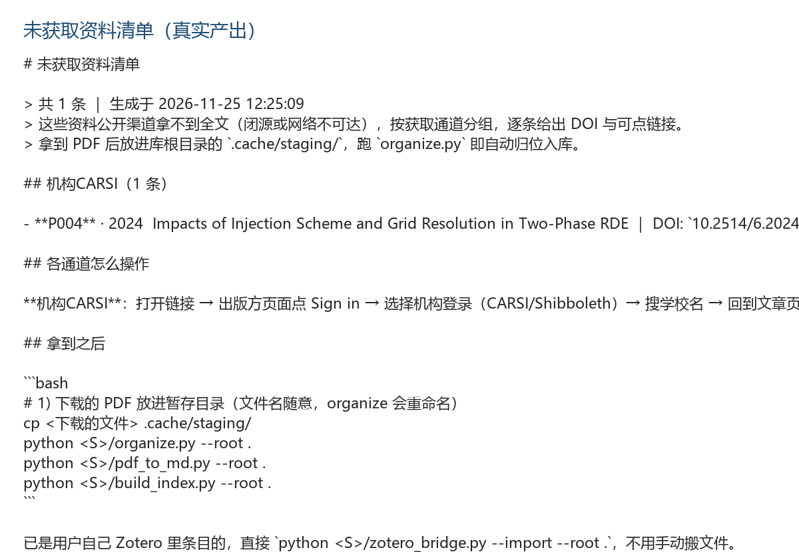
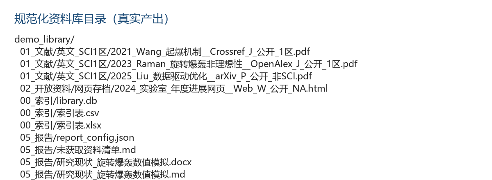
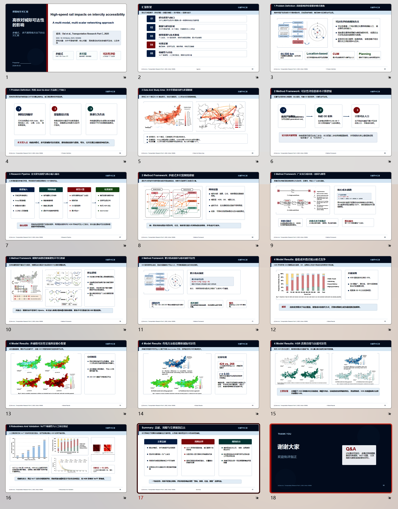

# survey-workbench-hub

[English](README_EN.md)

把一个关键词变成一间可查询的资料库，加一份能直接贴进基金本子的研究现状报告。覆盖检索、公开资料下载、规范化归档、PDF 解析、Excel/SQLite 索引、反复交互、按时间阶段写报告，以及由报告极度精简而成的科研汇报 PPT。

检索覆盖 10 个开放源（含国内直连的 PLOS / DataCite），另有 28 个中文与机构库的一键检索入口；机构授权询问是可选的，答「没有」直接走文献传递。

> **课题组编程学习网站**：<https://zerocode.xin/login>
>
> **交流群**：1061940027（QQ）
>
> 进入群或网站，可以免费学编程和 AI coding 知识、获取免费资源；做得好的后面有机会和我们团队一起共事，做实际工程任务。

## 1. 项目发起人与运营信息

### 1.1 发起人

由课题组维护，聚焦「把科研里重复的资料劳动标准化成可复用流程」。具体贡献者见 Git 提交历史。

### 1.2 免费学习资源

- 编程学习网站：<https://zerocode.xin/login>
- AI coding 与编程交流群：1061940027（QQ）

群与网站提供免费的编程/AI coding 教程与资源，也欢迎有工程能力的朋友一起参与实际任务。

### 1.3 商务合作

暂无固定合作通道，可通过交流群联系维护者。

## 2. 主要开发者

| 角色 | 内容 |
|---|---|
| 课题组 | 规则设计、流程编排、基金写作规范、验证 |
| 社区贡献者 | 数据源、OCR 后端、PPT 样式适配 |

## 3. 项目理念与社区

- **先证根因，再动手**：判定逻辑只实现一次；解析侧与清理脚本共用同一函数。
- **宁可「不确定」，也不编**：影响因子、分区、数值拿不到就留空；闭源文献给 DOI 与通道，不假装下载成功。
- **输出优先**：每个 skill 都返回能直接用的产物——索引表、报告 docx、PPT，而不是一段建议。
- **标准化即解放**：把重复的科研流程封装成 skill，让智能体直接复用，而不是靠口口相传。

## 4. 快速开始

安装后可用 `/survey-workbench` 直接触发，或在装好 skill 的 agent 里说一句：

```text
帮我按阶段梳理「旋转爆轰发动机数值模拟」的国内外研究现状，先建可查的资料库，最后给我报告和汇报 PPT。
```

skill 会在当前目录创建 `survey_<主题>/`，产出：

| 产物 | 位置 |
|---|---|
| 规范化资料库 | `01_文献/`、`02_开放资料/` |
| 可检索正文 | `03_解析全文/md/`、`txt/`、`tables/` |
| 索引 | `00_索引/索引表.xlsx`（七张表）+ `library.db` |
| 未获取清单 | `05_报告/未获取资料清单.md`（DOI + 可点链接） |
| 调研报告 | `05_报告/研究现状_<主题>.md` / `.docx` |
| 汇报 PPT | `05_报告/研究现状_<主题>.pptx` |

## 5. 安装

### 5.1 `npx skills`（推荐）

```bash
npx skills add pkssbttywblj/survey-workbench-hub --list
npx skills add pkssbttywblj/survey-workbench-hub --agent codex --skill survey-workbench --yes --copy
```

### 5.2 Claude Code

```bash
git clone https://github.com/pkssbttywblj/survey-workbench-hub.git ~/ai-skills/survey-workbench-hub
mkdir -p ~/.claude/skills
ln -s ~/ai-skills/survey-workbench-hub/skills/survey-workbench ~/.claude/skills/survey-workbench
```

### 5.3 WorkBuddy / Codex

把 `skills/survey-workbench` 整个目录复制到对应 skills 目录；Windows 上可用目录联接避免双份：

```cmd
mklink /J "%USERPROFILE%\.workbuddy\skills\survey-workbench" "C:\ai-skills\survey-workbench-hub\skills\survey-workbench"
```

### 5.4 其他 agent

保留完整目录结构（脚本、`references/`、`ppt_skill/` 都要），不要只复制 `SKILL.md`。

Python 依赖：

```bash
pip install openpyxl pymupdf pdfplumber python-docx beautifulsoup4
# 可选：curl_cffi 提高出版社站点下载成功率
```

## 6. 技能索引

| 技能 | 状态 | 用途 | 触发词 | 详情 |
|---|---|---|---|---|
| `survey-workbench` | Beta | 关键词 → 资料库 → 调研报告 → 汇报 PPT | 文献调研、建文献库、研究现状、下载论文和公开资料 | [说明](skills/survey-workbench/README.md) |

## 7. 贡献与开发

### 7.1 共享设计原则

1. 一手来源优先；规则写明理由，不只给断言。
2. 显式胜过隐式；每个判断都能追到原文位置。
3. 判定逻辑收口到一个函数，防止两处漂移。
4. 输出优先、自包含、可扩展。

### 7.2 仓库结构

```text
skills/survey-workbench/
├── SKILL.md            # 主入口
├── scripts/            # 15 个流程脚本（含 PPT 交接包生成）
├── references/         # 写作规范、命名、数据源、OCR 等
├── ppt_skill/          # 集成 CN Academic Spark 中文 PPT 引擎（MIT，含模板/图标/路线图）
├── templates/          # 精读卡片模板
└── evals/              # 评测用例
examples/demo_library/  # 真实跑出来的演示库
assets/                 # 效果图
```

### 7.3 新增技能流程

1. 在 `skills/` 下建目录；
2. 写 `SKILL.md`、中英 README；
3. 规则放 `references/`，脚本放 `scripts/`；
4. 在下方索引表添加一行；
5. 跑 `python scripts/validate_repo.py` 做一致性检查。

## 8. Star 历史

项目刚开始，欢迎 star 与反馈。

## 示例预览

| 产物 | 预览 |
|---|---|
| Excel 索引表 |  |
| Word 调研报告 |  |
| 未获取资料清单 |  |
| 规范化目录 |  |
| 汇报 PPT 总览（内置引擎的上游案例） |  |
| 多模态读页输入 |  |

> 效果图来自 `examples/demo_library/` 的真实运行；演示 PDF 为合成样例，仅用于展示流程。
