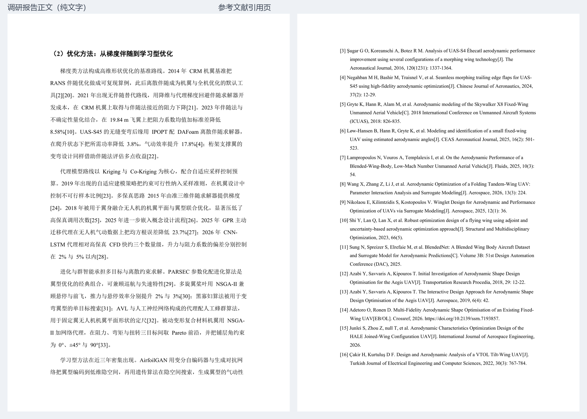

# survey-workbench-hub

[中文说明](README.md)

An Agent Skill repository for end-to-end literature surveys. Give it a research topic and specific questions, and it handles multi-source search, public full-text downloads, structured archiving, PDF parsing, Excel/SQLite indexing, research-status drafting, and academic presentation generation.

Search aggregates 10 open sources (including China-direct PLOS and DataCite) alongside one-click search entries for 28 Chinese and institutional databases. Closed-access papers are never scraped behind paywalls—each entry keeps its DOI and access routes. Institutional access is optional; without it, the workflow routes directly to document delivery.

> **Programming & AI Coding Site**: <https://zerocode.xin/login>
>
> **Community Group**: 1061940027 (QQ)
>
> Both share free programming and AI coding tutorials and resources. Strong contributors may also join our team on practical engineering projects.

## 1. About

Maintained by our research group to turn the repetitive literature work before a thesis proposal or grant application—searching, downloading, renaming, indexing, drafting research status, and making group-meeting slides—into a reusable workflow. See Git history for contributors, or reach us in the QQ group for questions and collaboration.

A few ground rules behind how this skill is built:

- **Leave unknown metadata blank**: Missing impact factors, quartiles, or paper numbers stay marked for verification; closed papers keep their DOI, failure reason, and retrieval route instead of faking downloads.
- **Keep logic in one place**: Archiving, deduplication, and index updates share the same underlying rules so files and spreadsheets never drift out of sync.
- **Deliver directly usable files**: Every stage leaves concrete folders, spreadsheets, reports, or editable slides rather than generic suggestions.

## 2. Quick Start

Once installed, trigger the skill with `/survey-workbench` or describe your topic and questions directly:

```text
Survey the research status of UAV aerodynamic shape optimization by stage. Build a searchable library first, then generate the report and presentation slides.
```

The skill creates `survey_<topic>/` in the current working directory:

| Output | Path |
|---|---|
| Archived papers & materials | `01_文献/`, `02_开放资料/` |
| Parsed full text & tables | `03_解析全文/md/`, `txt/`, `tables/` |
| Searchable index | `00_索引/索引表.xlsx` (7 sheets) + `library.db` |
| Pending manual downloads | `05_报告/未获取资料清单.md` (DOI + clickable links) |
| Survey report | `05_报告/研究现状_<topic>.md` / `.docx` |
| Presentation deck | `05_报告/<topic>_汇报.pptx` |

## 3. Installation & Dependencies

### 3.1 Install via `npx skills` (Recommended)

```bash
npx skills add pkssbttywblj/survey-workbench-hub --list
npx skills add pkssbttywblj/survey-workbench-hub --agent codex --skill survey-workbench --yes --copy
```

### 3.2 Claude Code

```bash
git clone https://github.com/pkssbttywblj/survey-workbench-hub.git ~/ai-skills/survey-workbench-hub
mkdir -p ~/.claude/skills
ln -s ~/ai-skills/survey-workbench-hub/skills/survey-workbench ~/.claude/skills/survey-workbench
```

### 3.3 WorkBuddy / Codex

Copy the entire `skills/survey-workbench` folder into the target agent's skills directory. On Windows, a directory junction avoids keeping duplicate copies:

```cmd
mklink /J "%USERPROFILE%\.workbuddy\skills\survey-workbench" "C:\ai-skills\survey-workbench-hub\skills\survey-workbench"
```

### 3.4 Other Agents & Python Dependencies

Keep the full folder structure intact (`scripts/`, `references/`, and `ppt_skill/` are all required); do not copy only `SKILL.md`.

Python packages:

```bash
pip install openpyxl pymupdf pdfplumber python-docx beautifulsoup4 python-pptx
# Optional: curl_cffi improves download success on some publisher sites
```

## 4. Skill Index

| Skill | Status | Purpose | Triggers | Details |
|---|---|---|---|---|
| `survey-workbench` | Beta | Keyword → library → survey report → presentation | literature survey, build a literature library, research status, download papers and public materials | [Details](skills/survey-workbench/README_EN.md) |

## 5. Repository Layout & Contributing

```text
skills/survey-workbench/
├── SKILL.md            # main workflow entry
├── scripts/            # 15 workflow scripts (search, parse, index, report check, PPT handoff)
├── references/         # writing spec, naming rules, sources, OCR, and portability guides
├── ppt_skill/          # bundled CN Academic Spark PPT engine (MIT)
├── templates/          # reading-note card template
└── evals/              # evaluation prompts
examples/demo_library/  # real run output
assets/                 # showcase screenshots & presentation files
```

To add data sources, OCR backends, PPT styles, or new skills:

1. Create a skill folder under `skills/` with `SKILL.md` and mirrored Chinese/English READMEs;
2. Place specs in `references/` and executable scripts in `scripts/`;
3. Add an entry to the Skill Index table above;
4. Run `python scripts/validate_repo.py` before committing to verify README parity, asset links, and Python syntax.

## 6. Real-Run Showcase

The showcase outputs below (literature library, Excel index, Word survey report, pending-download list, and multimodal page input) were generated directly using **WorkBuddy + DeepSeek V4.1 Flash** with `survey-workbench` and the following prompt:

```text
survey-workbench
,请你使用此skill在当前目录下对“无人机气动外形优化”进行调研，调研问题为：（1）找到给出详细几何参数的无人机模型；（2）调研出无人机气动外形优化所用的优化算法；（3）调研出无人机气动外形优化的难点和挑战，请执行
```

The **presentation deck** was regenerated from the same survey report and library using **Gemini 4 Neon** following this skill's Route D literature-review spec (18 fully editable native vector slides embedding source paper figures; files included in `assets/`: [Download PPTX](assets/无人机气动外形优化_汇报.pptx) | [View PDF](assets/无人机气动外形优化_汇报.pdf)).

| Output | Preview |
|---|---|
| Excel index |  |
| Word survey report |  |
| Manual-download list |  |
| Normalized directory tree |  |
| Presentation deck overview (regenerated with Gemini 4 Neon per skill spec) |  |
| Multimodal page reading input |  |
