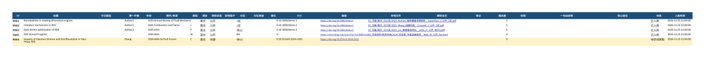
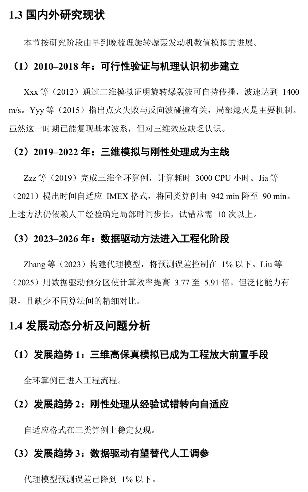
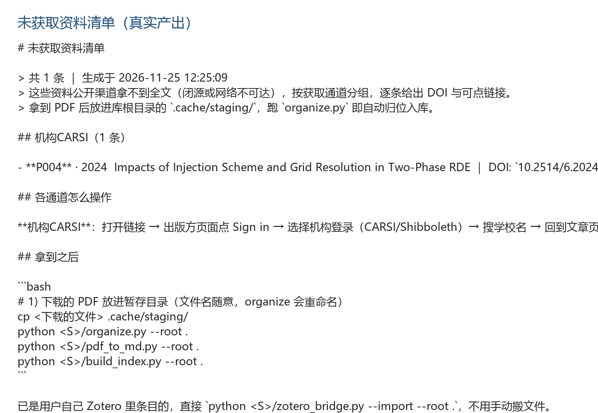
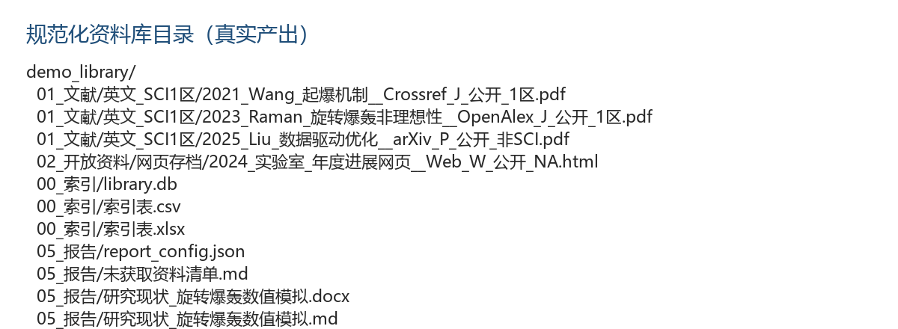
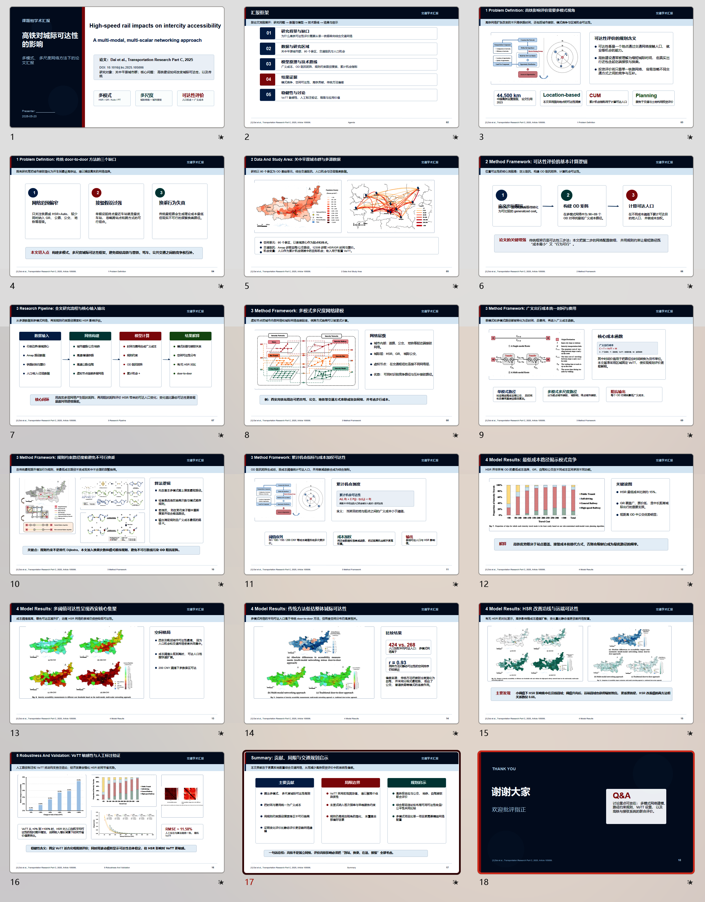

# survey-workbench-hub

[中文说明](README.md)

Turn a keyword into a searchable literature library plus a grant-style research-status report. It covers search, public downloads, normalized archiving, PDF parsing, Excel/SQLite indexing, iterative querying, time-ordered report drafting, and a condensed scientific PPT generated from the report.

Search spans 10 open sources (including China-direct PLOS and DataCite) plus one-click entry points to 28 Chinese and institutional databases. Asking about institutional access is optional; a "no" goes straight to document delivery.

> **Our lab's programming site**: <https://zerocode.xin/login>
>
> **Community group**: 1061940027 (QQ)
>
> Join the group or the site to learn programming and AI coding for free and get free resources. Strong contributors may later work with our team on real engineering tasks.

## 1. Founder and Operations

### 1.1 Founder

Maintained by our research group, focused on turning repetitive research chores into reusable workflows. See Git history for individual contributors.

### 1.2 Free Learning Resources

- Programming site: <https://zerocode.xin/login>
- Programming / AI coding group: 1061940027 (QQ)

Both provide free tutorials and resources, and welcome people who want to join real engineering work.

### 1.3 Business Cooperation

No fixed channel yet; reach the maintainers through the community group.

## 2. Main Developers

| Role | Scope |
|---|---|
| Research group | Rule design, workflow, grant-writing spec, validation |
| Community contributors | Data sources, OCR backends, PPT style adaptation |

## 3. Philosophy and Community

- **Prove the root cause before fixing.** Each judgment lives in one function only.
- **Prefer "uncertain" over invented.** Missing impact factors, quartiles, or numbers stay blank; closed papers get DOI and access routes instead of fake downloads.
- **Outputs first.** Every skill returns something usable: index tables, a report .docx, a PPT.
- **Standardization is liberation.** Package repeated research workflows so agents can reuse them.

## 4. Quick Start

Trigger it with `/survey-workbench`, or just ask an agent with the skill installed:

```text
Survey the research status of rotating detonation engine simulation by stage. Build a searchable library first, then give me the report and a presentation.
```

The skill creates `survey_<topic>/` in the current directory:

| Output | Location |
|---|---|
| Normalized library | `01_文献/`, `02_开放资料/` |
| Searchable text | `03_解析全文/md/`, `txt/`, `tables/` |
| Index | `00_索引/索引表.xlsx` (7 sheets) + `library.db` |
| Manual-download list | `05_报告/未获取资料清单.md` (DOI + clickable links) |
| Report | `05_报告/研究现状_<topic>.md` / `.docx` |
| Presentation | `05_报告/研究现状_<topic>.pptx` |

## 5. Installation

### 5.1 `npx skills` (recommended)

```bash
npx skills add pkssbttywblj/survey-workbench-hub --list
npx skills add pkssbttywblj/survey-workbench-hub --agent codex --skill survey-workbench --yes --copy
```

### 5.2 Claude Code

```bash
git clone https://github.com/pkssbttywblj/survey-workbench-hub.git ~/ai-skills/survey-workbench-hub
mkdir -p ~/.claude/skills
ln -s ~/ai-skills/survey-workbench-hub/skills/survey-workbench ~/.claude/skills/survey-workbench
```

### 5.3 WorkBuddy / Codex

Copy the whole `skills/survey-workbench` directory into the matching skills folder. On Windows, a directory junction avoids duplicates:

```cmd
mklink /J "%USERPROFILE%\.workbuddy\skills\survey-workbench" "C:\ai-skills\survey-workbench-hub\skills\survey-workbench"
```

### 5.4 Other Agents

Keep the complete directory structure (scripts, `references/`, `ppt_skill/`); do not copy only `SKILL.md`.

Python dependencies:

```bash
pip install openpyxl pymupdf pdfplumber python-docx beautifulsoup4
# optional: curl_cffi improves downloads from publisher sites
```

## 6. Skill Index

| Skill | Status | Purpose | Triggers | Details |
|---|---|---|---|---|
| `survey-workbench` | Beta | keyword → library → report → presentation | literature survey, build a literature library, research status, download papers and public materials | [README](skills/survey-workbench/README.md) |

## 7. Contribution and Development

### 7.1 Shared Design Principles

1. Prefer primary sources; explain why each rule exists.
2. Explicit over implicit; every judgment traces back to the source text.
3. One implementation per judgment to prevent drift.
4. Outputs first, self-contained, extensible.

### 7.2 Repository Layout

```text
skills/survey-workbench/
├── SKILL.md            # main entry
├── scripts/            # 15 workflow scripts (incl. PPT handoff builder)
├── references/         # writing spec, naming, sources, OCR
├── ppt_skill/          # bundled CN Academic Spark engine (MIT; templates/icons/route library)
├── templates/          # reading-note card template
└── evals/              # evaluation prompts
examples/demo_library/  # real run output
assets/                 # screenshots
```

### 7.3 Adding a Skill

1. Create a directory under `skills/`;
2. Write `SKILL.md` and mirrored Chinese/English READMEs;
3. Put rules in `references/`, scripts in `scripts/`;
4. Add a row to the skill index above;
5. Run `python scripts/validate_repo.py` for consistency checks.

## 8. Star History

The project is new; stars and feedback are welcome.

## Example Preview

| Output | Preview |
|---|---|
| Excel index |  |
| Word report |  |
| Manual-download list |  |
| Directory tree |  |
| PPT overview (upstream case of the bundled engine) |  |
| Page image for multimodal reading |  |

> Screenshots come from a real run of `examples/demo_library/`. Demo PDFs are synthetic and only illustrate the workflow.
